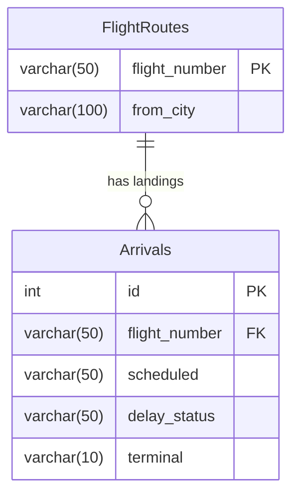

# Flight Arrivals Management System (`JDBC_FlightManager`)

**Course:** Software Engineering Methods (Academic Year 2026–2027)  
**Institution:** Braude College of Engineering | Department of Software Engineering  
**Database Engine:** MySQL 8.0+ | **Language:** Java 25 LTS (JDBC)

---

## 1. Project Description
`JDBC_FlightManager` is a Java Data Access Layer (DAL) and relational database engineering project built around real-world flight arrival records (`arrived_flights.csv`, 299 records). The workflow spans automated CSV ingestion into MySQL 8.0+, schema normalization into Third Normal Form (3NF) assisted by a local LLM (`Qwen2.5-Coder-7B-Instruct`), and programmatic database operations via JDBC.

Key implemented components include:
- **Relational Queries & Reporting (`FlightManagerBase`, `FlightViewer`):** Executing `INNER JOIN` queries across `Arrivals` and `FlightRoutes` with terminal-based filtering and chronological sorting (`ORDER BY scheduled ASC`).
- **Batch Processing (`AdvancedFlightDispatcher`):** High-throughput multi-row updates using `PreparedStatement`, `addBatch()`, and `executeBatch()` for arrival IDs `(1, 3, 5)`.
- **Security Hardening (`SimpleFlightUpdater`):** Demonstrating a live SQL Injection vulnerability via string-concatenated `Statement` queries and remediating it using parameterized `PreparedStatement` binding.

---

## 2. Engineering Team Details (Single-Workstation Driver–Navigator)

| Role | Full Name | Student ID | Braude Academic Email |
| :--- | :--- | :--- | :--- |
| **Student A** | `Yaakov Fumm` | `--` | `Yaakov.Fumm@e.braude.ac.il` |

- **Group Number:** `G[XX]`
- **GitHub Repository URL:** `https://github.com/[Username]/JDBC_FlightManager`

---

## 3. Technology Stack
- **Runtime & JDK:** BellSoft Liberica Full JDK 25 LTS
- **Database Server:** MySQL Server 8.0+ (`FlightDB` schema, exported to `FlightDB_Dump.sql`)
- **JDBC Driver:** MySQL Connector/J 9.5.0 (`../JDBC_FlightManager/lib/mysql-connector-j-9.5.0.jar`)
- **IDE & Database Tooling:** IntelliJ IDEA Ultimate (Built-in Database Console & SQL Generator)
- **Local AI Assistant:** LM Studio (`Qwen2.5-Coder-7B-Instruct`) integrated via the Continue plugin
- **Version Control:** Git & GitHub

---

## 4. Database Normalization (3NF) & Functional Dependencies ($F$)

### 4.1 Functional Dependencies ($F$) in `rawflights`
In the initial flat staging table `rawflights(scheduled, flight, fromC, delay, terminal)`, each landing event is uniquely identified by an arrival instance, while route origin metadata depends strictly on the flight code:
- $\text{flight} \rightarrow \text{fromC}$ (Each flight number consistently originates from a single departure city).
- $\text{id} \rightarrow \{\text{flight}, \text{scheduled}, \text{delay}, \text{terminal}\}$ (Each specific landing instance determines its flight code, scheduled arrival time, delay status, and assigned terminal).

### 4.2 Why `rawflights` Violated 3NF
`rawflights` violated **Third Normal Form (3NF)** because a non-prime attribute (`fromC`) was functionally dependent on another non-key attribute (`flight`), creating a **transitive dependency** ($\text{Arrival Instance} \rightarrow \text{flight} \rightarrow \text{fromC}$). Storing `fromC` redundantly across all 299 arrival rows introduced three data anomalies:
- **Update Anomaly:** Changing the origin city name for a given flight required updating multiple rows; partial updates would leave conflicting `fromC` values for the same flight.
- **Insertion Anomaly:** A new flight route (`flight`, `fromC`) could not be recorded in the database until at least one scheduled arrival event existed for it.
- **Deletion Anomaly:** Deleting the last remaining arrival record for a flight would permanently erase the route's origin city (`fromC`) mapping from the database.

### 4.3 Decomposed 3NF Relational Schema
Decomposing `rawflights` into two tables eliminates transitive dependencies and isolates route master data from operational arrival events:

1. **`FlightRoutes`** *(Parent Reference Table)*
    - `flight_number` (`VARCHAR(50)`, **Primary Key**) — Unique flight identifier.
    - `from_city` (`VARCHAR(100)`) — Departure city associated with the route.
2. **`Arrivals`** *(Child Operational Table)*
    - `id` (`INT`, **Primary Key**, `AUTO_INCREMENT`) — Surrogate unique identifier for each arrival record.
    - `flight_number` (`VARCHAR(50)`, **Foreign Key** $\rightarrow$ `FlightRoutes(flight_number)`) — Links each landing to its route.
    - `scheduled` (`VARCHAR(50)`) — Scheduled arrival timestamp/time.
    - `delay_status` (`VARCHAR(50)`) — Current landing/delay status.
    - `terminal` (`VARCHAR(10)`) — Assigned airport terminal (`2`, `3`, `4`, or `5`).

---

## 5. Independent AI Prompt (Part 4 – `FlightViewer.java`)

```text
    Write a complete Java class named FlightViewer with a main method.
    
    Ask for the database password using Scanner and connect to MySQL FlightDB using URL: "jdbc:mysql://localhost:3306/FlightDB?allowLoadLocalInfile=true&allowPublicKeyRetrieval=true&serverTimezone=Asia/Jerusalem&useSSL=false" and user "root".
    
    Always use try-with-resources for Connection, PreparedStatement, and ResultSet.
    
    In main(), use the same Scanner to prompt the user for a target Terminal number (valid terminals in dataset: 2, 3, 4, 5).
    
    Execute a SELECT query using a single PreparedStatement with an INNER JOIN between Arrivals and FlightRoutes on their shared flight column, filtering WHERE Arrivals.terminal = ? and sorting ORDER BY Arrivals.scheduled ASC.
    
    CRITICAL: Bind the user's terminal input as a String using pstmt.setString(1, terminal) (because Arrivals.terminal is VARCHAR(10))—do not use setInt.
    
    Iterate through the ResultSet and print all matching flight records in a clean, formatted table showing scheduled time, flight number, origin city (fromC), delay status, and terminal. If no flights are found for that terminal, print a clear message indicating no records matched.
```
## 6. Entity Relationship Diagram (ERD)


---

## 7. Security Audit Summary (Part 5 – SQL Injection Mitigation)
- **Attack Payload Tested:** `Landed' #`
- **Vulnerability Analysis (`Statement`):** In the initial `SimpleFlightUpdater` implementation, user input was concatenated directly into the SQL command string:

      UPDATE Arrivals SET delay_status = 'Landed' #' WHERE id = 1

  The single quote (`'`) prematurely closed the string literal for `delay_status`, and the MySQL comment token (`#`) commented out the entire `WHERE id = 1` clause. Without a filtering condition, MySQL executed an unconditional update across the table, overwriting `delay_status` to `'Landed'` on all **299 rows**.
- **Remediation (`PreparedStatement`):** Refactoring `SimpleFlightUpdater` to use a parameterized query (`UPDATE Arrivals SET delay_status = ? WHERE id = ?`) with `pstmt.setString(1, status)` separated the SQL syntax tree from user-supplied data. The MySQL engine pre-compiled the query structure before binding the parameters, treating `Landed' #` strictly as a literal string value. Consequently, only the single targeted row (`id = 1`) was updated with the literal string `Landed' #`, leaving the remaining **298 rows** intact.

---

## 8. License
Distributed under the **Braude College Academic License** (Software Engineering Methods, 2026–2027).